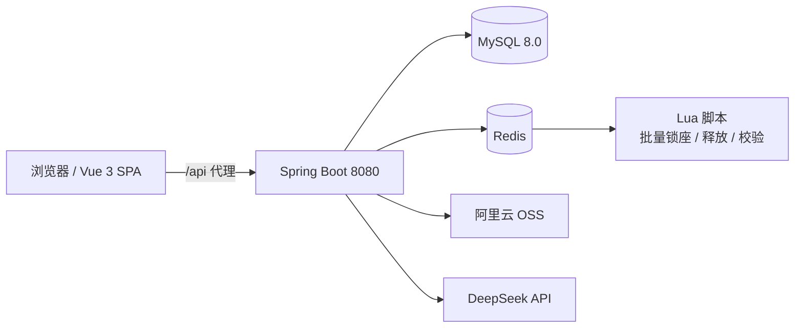

# 星光影院 · 在线电影购票系统

一个前后端分离的电影票务系统，包含**管理端**、**用户端**和一个**能真实查询、选座、锁座、下单、支付的 AI 观影助手**。

后端基于 Spring Boot 3 + MySQL + Redis 实现，前端基于 Vue 3 + Element Plus，AI 部分使用 Spring AI 接入 DeepSeek，并采用 Redis + Lua 脚本保证高并发选座的原子性。

---

## 目录

- [功能特性](#功能特性)
- [技术栈](#技术栈)
- [系统架构](#系统架构)
- [核心设计](#核心设计)
- [项目结构](#项目结构)
- [快速开始](#快速开始)
- [配置说明](#配置说明)
- [主要接口](#主要接口)
- [数据表说明](#数据表说明)
- [AI 工具清单](#ai-工具清单)
- [已知限制](#已知限制)

---

## 功能特性

### 管理端

| 模块 | 能力 |
| --- | --- |
| 数据看板 | 今日票房、近 7 日票房趋势、订单状态分布、影片/影厅/用户统计（ECharts） |
| 电影管理 | 电影增删改查、上下架、海报上传（阿里云 OSS）、类型/国家/语言字典转换 |
| 影厅管理 | 影厅增删改查、座位布局（rows × cols）、容量配置 |
| 场次管理 | 排片新增/修改/删除、停售、按时间段查询、场次余票与座位状态 |
| 订单管理 | 订单分页查询、订单详情、支付、退票、按状态统计 |
| 公告管理 | 公告发布、编辑、上下架、删除 |
| 用户管理 | 用户分页查询、启用/禁用、重置密码、用户详情与消费统计 |
| 文件上传 | 图片上传至阿里云 OSS 并返回访问地址 |

### 用户端

- 首页：轮播图、预告片、Top100 榜单
- 电影浏览：正在热映 / 即将上映、按类型筛选、电影详情
- 选场次：按日期查看排片、场次时间、票价、余票
- 可视化选座：实时展示已售、已被他人锁定、已锁定座位
- 下单支付：座位锁定 → 生成待支付订单 → 15 分钟支付倒计时 → 超时自动取消
- 我的订单：订单列表、订单详情、取消订单
- 公告展示（接口 `/users/notice` 已提供）
- 双端登录：管理员与普通用户分别登录，前端路由按角色做权限拦截

### AI 观影助手「小星星」

- 流式输出，前端逐字渲染（打字机效果）
- 基于 Spring AI `@Tool` 的 **10 个业务工具**，可真实查询电影、场次、余票、订单并完成抢座下单
- 多轮对话记忆持久化到 MySQL，按用户隔离会话
- 支持历史会话列表与历史消息回显
- 工具返回的数据由模型输出为 HTML 表格，前端 `v-html` 直接渲染

---

## 技术栈

| 层次 | 技术 |
| --- | --- |
| 后端 | Java 17、Spring Boot 3.4.5、Spring Web、Bean Validation、AOP |
| 持久层 | MyBatis-Plus 3.5.17、PageHelper、Druid 连接池、MySQL 8.0 |
| 缓存/并发 | Redis、StringRedisTemplate、Lua 脚本（原子批量锁座） |
| 认证安全 | JWT（jjwt 0.11.5）、BCrypt 密码加密、HandlerInterceptor 登录拦截 |
| AI | Spring AI 1.0.0、DeepSeek Chat Model、Tool Calling、Chat Memory |
| 接口文档 | Knife4j 4.5.0（OpenAPI 3） |
| 对象存储 | 阿里云 OSS SDK 3.18.4 |
| 前端 | Vue 3.5、Vite 8、Vue Router 4、Pinia 风格本地状态、Axios |
| UI / 可视化 | Element Plus 2.14、ECharts 6 |

---

## 系统架构



前后端分离部署：前端开发环境通过 Vite 代理将 `/api` 转发到 `http://localhost:8080`，生产环境可交给 Nginx 反向代理。

---

## 核心设计

### 1. 高并发选座：Redis + Lua 原子锁

座位锁的 Redis Key 结构：

```
seat:{sessionId}:{seatRow}:{seatCol}  →  value = "{userId}:{timestamp}"，TTL = 5 分钟
```

三个 Lua 脚本保证原子性：

| 脚本 | 作用 |
| --- | --- |
| `batchLock.lua` | 一次性锁定多个座位；任意一个座位已被占用则全部回滚，避免“部分锁定” |
| `releaseLock.lua` | 校验锁的归属后释放，只有锁的主人才能释放，防止误删他人锁 |
| `verifyLock.lua` | 提交订单前批量校验座位锁归属，通过后才写订单与 `seat_lock` 表 |

完整链路：

```
选座 → batchLock.lua 原子锁座（5 分钟）
     → submitOrder → verifyLock.lua 校验归属
     → 写入 order + order_item + seat_lock
     → order:timeout（ZSET）登记 15 分钟后超时
     → 支付成功：移除超时任务，座位正式售出
     → 主动取消 / 超时：批量释放 Redis 锁与 seat_lock 记录
```

### 2. 订单超时自动取消：Redis ZSET 延迟队列

- 下单后写入 `order:timeout`，`score = 当前时间 + 15 分钟`
- 消费者每秒扫描到期订单并处理
- **三层幂等保障**：
  1. `ZREM` 原子消费标记，多节点部署时同一条消息只会被消费一次
  2. `setIfAbsent` 分布式锁，避免超时取消与用户主动取消并发
  3. 订单状态二次校验，仅 `status = 0`（待支付）才执行取消
- 处理失败时不删除 ZSET 成员，下一轮自动重试

### 3. AI 客服的工程细节

- **流式上下文传递**：Reactor 流式订阅在线程池线程执行，`ThreadLocal` 不可用，因此从 `Authorization` 解析 `userId` 后通过 Spring AI 的 `ToolContext` 传入工具层
- **会话隔离**：`conversationId = userId:chatId`，按会话 ID 查询即完成用户隔离
- **历史裁剪**：每次请求最多携带最近 20 条消息，避免对话历史无限膨胀拖慢首字响应
- **输出格式约束**：System Prompt 强制模型用 HTML `<table>` 输出列表数据，前端直接渲染
- **敏感操作二次确认**：取消订单、锁座、下单必须先在对话中展示信息并取得用户确认，禁止跳步执行

---

## 项目结构

```
27Gproject/
├── movie_system/                 # 后端
│   ├── images/                   # 设计图/截图
│   └── movie/
│       ├── pom.xml
│       └── src/main/
│           ├── java/com/example/movie/
│           │   ├── controller/   # admin / user / ai 三组控制器
│           │   ├── service/      # 业务接口与实现
│           │   ├── mapper/       # MyBatis-Plus Mapper
│           │   ├── entity/       # 实体类
│           │   ├── dto/ bedto/ aidomain/ vo/
│           │   ├── tools/        # MovieTools：AI 的 10 个 @Tool
│           │   ├── common/       # Result、PageResult、UserContext、ChatMemory
│           │   ├── config/       # ChatClient、Knife4j、OSS、MVC 配置
│           │   ├── interceptor/  # JWT 登录拦截器
│           │   ├── task/         # 订单超时消费者、日志清理、性能切面
│           │   └── Utils/        # JWT、OSS、字典转换工具
│           └── resources/
│               ├── application.yml
│               ├── application-dev.yml
│               ├── lua/          # batchLock / releaseLock / verifyLock
│               └── Mapper/       # MyBatis XML
├── movie-front/                 # 前端
│   ├── package.json
│   ├── vite.config.js           # /api → localhost:8080 代理
│   └── src/
│       ├── api/                 # 按模块拆分的接口封装
│       ├── router/              # 管理端 + 用户端路由与权限守卫
│       ├── views/               # login / home / movie / hall / session / order / user ...
│       ├── components/          # AiService 聊天组件、RobotAvatar
│       └── utils/request.js     # Axios 实例与 Token 注入
├── chat_history.sql             # AI 会话列表表结构
├── chat_message.sql             # AI 消息表结构
├── seat_lock.sql                # 座位锁表结构
└── README.md
```

---

## 快速开始

### 环境要求

| 依赖 | 版本 |
| --- | --- |
| JDK | 17+ |
| Maven | 3.8+ |
| MySQL | 8.0+ |
| Redis | 6.0+ |
| Node.js | 18+ |

### 1. 初始化数据库

```sql
CREATE DATABASE `movie_system` DEFAULT CHARACTER SET utf8mb4 COLLATE utf8mb4_general_ci;
```

导入表结构：

- `chat_history.sql` — AI 会话列表
- `chat_message.sql` — AI 对话消息
- `seat_lock.sql` — 座位锁记录

> 业务表（`user`、`movie`、`hall`、`session`、`order`、`order_item`、`notice`、`home_line`）请从本地数据库导出后一并导入。仓库中的三个 SQL 脚本只覆盖 AI 会话与座位锁相关表。

### 2. 配置敏感信息

敏感配置通过环境变量注入，不写入代码仓库。两种方式任选其一：

**方式一：本地私有配置文件（推荐本地开发）**

在 `movie_system/movie/src/main/resources/` 下创建 `application-local.yml`（该文件已被 `.gitignore` 忽略）：

```yaml
sky:
  datasource:
    password: 你的数据库密码
alioss:
  access-key-id: 你的AccessKeyId
  access-key-secret: 你的AccessKeySecret
jwt:
  secret: 你的Base64密钥
```

`application.yml` 中已配置 `spring.profiles.active: dev,local`，启动时会自动加载该文件。

**方式二：环境变量**

```powershell
# 必填：DeepSeek API Key
$env:DEEPSEEK_API_KEY="sk-你的密钥"

# 必填：MySQL 密码
$env:MYSQL_PASSWORD="你的数据库密码"

# 必填：JWT 签名密钥（Base64 或普通字符串均可）
$bytes = New-Object 'byte[]' 48
[System.Security.Cryptography.RandomNumberGenerator]::Create().GetBytes($bytes)
$env:JWT_SECRET = [Convert]::ToBase64String($bytes)

# 可选：图片上传功能需要
$env:ALIYUN_OSS_ACCESS_KEY_ID="你的AccessKeyId"
$env:ALIYUN_OSS_ACCESS_KEY_SECRET="你的AccessKeySecret"
```

> 环境变量只在当前终端会话生效。用 IDEA 启动时，请把上述变量配置到 Run Configuration 的 Environment variables 中，或使用系统环境变量。

### 3. 启动后端

```powershell
cd movie_system/movie
mvn spring-boot:run
```

启动成功后：

- 后端服务：http://localhost:8080
- 接口文档（Knife4j）：http://localhost:8080/doc.html

### 4. 启动前端

```powershell
cd movie-front
npm install
npm run dev
```

访问 http://localhost:5173 ：

- 管理端登录：`/login`
- 用户端登录：`/users/login`

> 前端 `/api` 请求由 Vite 代理转发到 `http://localhost:8080`，后端需使用 8080 端口。

### 5. 构建生产包

```powershell
cd movie-front
npm run build     # 产物在 dist/
```

---

## 配置说明

| 环境变量 | 默认值 | 说明 |
| --- | --- | --- |
| `MYSQL_HOST` | `localhost` | MySQL 地址 |
| `MYSQL_PORT` | `3306` | MySQL 端口 |
| `MYSQL_DATABASE` | `movie_system` | 数据库名 |
| `MYSQL_USERNAME` | `root` | 数据库账号 |
| `MYSQL_PASSWORD` | 空 | 数据库密码（必填） |
| `REDIS_HOST` | `localhost` | Redis 地址 |
| `REDIS_PORT` | `6379` | Redis 端口 |
| `REDIS_PASSWORD` | 空 | Redis 密码（无密码可留空） |
| `REDIS_DATABASE` | `8` | Redis 库号 |
| `DEEPSEEK_API_KEY` | 无 | DeepSeek 密钥（必填） |
| `JWT_SECRET` | 空 | JWT 签名密钥（必填），支持 Base64 或普通字符串 |
| `JWT_EXPIRE` | `43200000` | Token 有效期（毫秒），默认 12 小时 |
| `ALIYUN_OSS_ENDPOINT` | `oss-cn-beijing.aliyuncs.com` | OSS Endpoint |
| `ALIYUN_OSS_ACCESS_KEY_ID` | 空 | OSS AccessKey ID |
| `ALIYUN_OSS_ACCESS_KEY_SECRET` | 空 | OSS AccessKey Secret |
| `ALIYUN_OSS_BUCKET_NAME` | `javaself` | OSS Bucket 名称 |

其他非敏感配置（模型名称、上传大小限制等）仍在 `application.yml` 中维护。

> **安全提示**：
> - 仓库中的配置文件已不含任何真实密钥，全部改为环境变量占位符。
> - 请不要把 `.env`、运行配置或包含密钥的截图提交到仓库。
> - 若曾将真实 AccessKey 提交到公开仓库，请立即到阿里云控制台禁用并重新生成。

---

## 主要接口

### 用户端

| 方法 | 路径 | 说明 |
| --- | --- | --- |
| POST | `/users/login` | 普通用户登录 |
| POST | `/users/register` | 用户注册 |
| GET | `/users/home` | 首页数据 |
| GET | `/users/home/Trailer` | 预告片列表 |
| GET | `/users/home/Top100` | Top100 榜单 |
| GET | `/users/plus/{id}` | 电影详情与排片 |
| GET | `/users/hall/plus/{sessionId}` | 场次座位布局与占用情况 |
| POST | `/users/hall/seat` | 锁定座位（Redis + Lua） |
| POST | `/users/hall/seat/yes` | 提交订单 |
| POST | `/users/hall/seat/release` | 释放座位 |
| GET | `/users/orders` | 我的订单 |
| GET | `/users/orders/plus` | 订单详情 |
| POST | `/users/orders/cancel` | 取消订单 |
| GET | `/users/notice` | 公告列表 |

### 管理端

| 方法 | 路径 | 说明 |
| --- | --- | --- |
| POST | `/login` | 管理员登录 |
| GET/POST/PUT/DELETE | `/movie` … | 电影管理 |
| GET/POST/PUT/DELETE | `/hall` … | 影厅管理 |
| GET/POST/PUT/DELETE | `/session` … | 场次管理 |
| GET/PUT | `/order` … | 订单管理、支付、退票 |
| GET/POST/PUT/DELETE | `/notice` … | 公告管理 |
| GET/PUT/DELETE | `/user` … | 用户管理 |
| GET | `/homeline/*` | 票房统计与看板数据 |
| POST | `/upload` | 图片上传至 OSS |

### AI 客服

| 方法 | 路径 | 说明 |
| --- | --- | --- |
| GET | `/ai/service` | 流式对话（`text/html`，SSE 风格流式返回） |
| GET | `/ai/history/{type}` | 当前用户的会话列表 |
| GET | `/ai/history/{type}/{chatId}` | 指定会话的历史消息 |

---

## 数据表说明

| 表名 | 说明 |
| --- | --- |
| `user` | 用户（管理员/普通用户、状态、头像等） |
| `movie` | 电影（名称、导演、主演、类型编码、时长、上映日期、评分、海报） |
| `hall` | 影厅（名称、容量、座位布局 JSON） |
| `session` | 场次（电影、影厅、开始/结束时间、票价、状态） |
| `order` | 订单（订单号、用户、场次、金额、状态、创建/更新时间） |
| `order_item` | 订单座位明细（场次、排、列、票价） |
| `seat_lock` | 座位锁记录（场次、座位、用户、关联订单） |
| `notice` | 公告 |
| `home_line` | 首页轮播/推荐位 |
| `chat_history` | AI 会话列表（`type + chat_id` 唯一） |
| `chat_message` | AI 对话消息（角色、内容、会话 ID、用户 ID） |

订单状态：`0` 待支付、`1` 已支付、`2` 已取消、`3` 已退款。

---

## AI 工具清单

AI 助手的全部能力通过 Spring AI 的 `@Tool` 暴露：

| 工具 | 能力 |
| --- | --- |
| `queryMovie` | 按名称、类型、导演、状态等条件查询电影 |
| `queryMovieSession` | 一个工具覆盖上映日期、最早场次、某日余票、某时段余票、单场次详情 5 种场景 |
| `queryMyOrders` | 查询当前登录用户自己的订单，可按电影名、状态过滤 |
| `cancelMovieOrder` | 取消待支付订单（需先查询并由用户确认） |
| `querySeats` | 查询场次座位网格与占用情况（已售 / 他人锁定 / 本人锁定） |
| `recommendSeats` | 按“最后一排、前排、中间、左侧、右侧、相邻连座”等模糊偏好推荐座位 |
| `lockSeats` | 原子批量锁定座位（TTL 5 分钟） |
| `submitOrder` | 提交待支付订单 |
| `releaseSeats` | 释放当前用户已锁定的座位 |
| `payOrder` | 支付当前用户的待支付订单 |

标准抢票流程：

```
queryMovieSession 找场次
  → recommendSeats / querySeats 选座
  → 向用户展示座位与票价并确认
  → lockSeats 锁座
  → 用户确认后 submitOrder 下单
  → payOrder 支付
```

---

## 已知限制

- 支付为模拟支付，未接入真实支付渠道
- 选座锁的 TTL 为 5 分钟，订单支付窗口为 15 分钟
- 图片存储依赖阿里云 OSS，需要自行配置 Bucket 与跨域规则
- 仓库未包含完整业务表结构与初始数据，需从本地数据库导出

---

如果这个项目对你有帮助，欢迎点一个 Star ⭐
